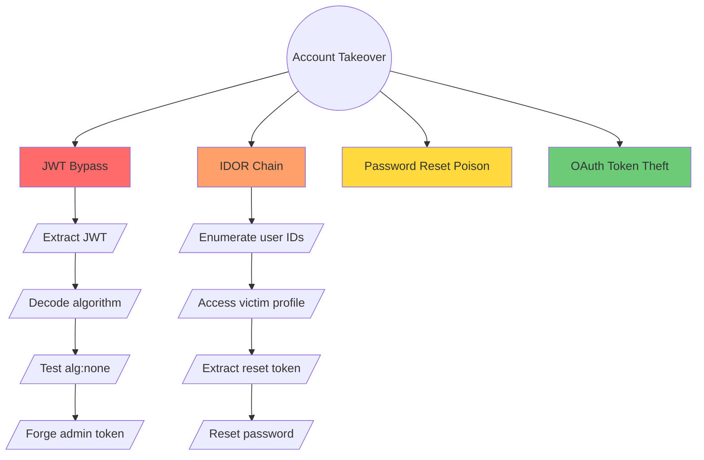

---
description: "Build attack tree for complex targets"
---

# /attack-tree — Build Attack Tree for Complex Targets

> **Purpose:** Visualize và prioritize attack paths khi target có nhiều entry points.
> **When to use:** Target có > 10 endpoints, multiple auth levels, hoặc complex business logic.
> **Output:** `targets/<slug>/attack-tree.md` + Mermaid diagram

---

## Prerequisites

- [ ] `/preflight` đã chạy
- [ ] `targets/<slug>/deep-dive.md` đã hoàn thành (ít nhất Section 1-3)

---

## Workflow

### Step 1: Define Root Goal

Xác định attacker's ultimate goal từ context của target:

```
Target type → Common root goals:
- E-commerce → Account takeover, Payment fraud, Data theft
- Enterprise SaaS → Privilege escalation, Data exfiltration, API abuse
- Financial → Account takeover, Transaction manipulation, PII theft
- Healthcare → PHI exfiltration, Prescription manipulation
- Gaming → Account takeover, In-game currency manipulation
```

**Output:** Root goal statement (1 sentence)

---

### Step 2: Enumerate Attack Paths (OR nodes)

List tất cả INDEPENDENT paths có thể đạt root goal.

**Sources to check:**
1. `targets/<slug>/deep-dive.md` Section 2 (Trust Boundaries)
2. `targets/<slug>/deep-dive.md` Section 3 (High-Value Zones)
3. `targets/<slug>/deep-dive.md` Section 7 (Attack Hypotheses)
4. `targets/<slug>/recon/` — endpoints discovered
5. JS analysis secrets/endpoints

**Path template:**
```markdown
| Path ID | Name | Entry Point | Description |
|---------|------|-------------|-------------|
| P1 | Direct Auth Bypass | /api/login | JWT alg:none or weak secret |
| P2 | IDOR to ATO | /api/user/{id} | Access other user's profile → extract reset token |
| P3 | Password Reset Poison | /forgot-password | Host header injection → redirect reset link |
| P4 | OAuth Token Theft | /oauth/callback | Open redirect → steal access_token |
```

---

### Step 3: Score Each Path

Apply scoring matrix:

| Attribute | TRIVIAL (1) | LOW (2) | MEDIUM (3) | HIGH (4) | EXPERT (5) |
|-----------|-------------|---------|------------|----------|------------|
| **Difficulty** | Default creds | Public exploit | Custom payload | Chain required | Novel research |
| **Time** | < 1 hour | 1-4 hours | 4-8 hours | 1-2 days | > 2 days |
| **Detection Risk** | None (passive) | Low (few requests) | Medium (scanning) | High (noisy) | Certain (alert) |

**Bounty Potential:** Map từ program.json severity → bounty tiers

**Priority Score = Difficulty + Time + DetectionRisk - (BountyPotential / 2)**

Lower score = Test first

---

### Step 4: Decompose Top Path (AND nodes)

For path với lowest priority score, break down into sequential steps:

```
[Root Goal: Account Takeover]
    │
    ├── [P1: JWT Bypass] ──────────────────────────────────
    │       │
    │       ├── Step 1: Extract JWT from localStorage
    │       ├── Step 2: Decode and identify algorithm
    │       ├── Step 3: Test alg:none bypass
    │       └── Step 4: Forge admin token
    │
    └── [P2: IDOR Chain] ─────────────────────────────────
            │
            ├── Step 1: Enumerate user IDs (predictable?)
            ├── Step 2: Access /api/user/{victim_id}
            ├── Step 3: Extract password reset token
            └── Step 4: Reset password → ATO
```

---

### Step 5: Generate Mermaid Diagram



**Color coding:**
- 🔴 Red: Test first (lowest score)
- 🟠 Orange: Test second
- 🟡 Yellow: Test third
- 🟢 Green: Test last (highest score)

---

### Step 6: Save Attack Tree

Write to `targets/<slug>/attack-tree.md`:

```markdown
# Attack Tree — {TARGET_NAME}

Generated: {DATE}
Root Goal: {GOAL}

## Path Priority

| Rank | Path | Priority Score | Status |
|------|------|----------------|--------|
| 1 | {path} | {score} | UNTESTED |
| 2 | {path} | {score} | UNTESTED |

## Attack Tree Diagram

{MERMAID_DIAGRAM}

## Path Details

### P1: {name}
- **Entry:** {entry_point}
- **Steps:** {step_list}
- **Tools:** {tools_needed}
- **Mitigations to bypass:** {mitigations}

### P2: ...

## Testing Log

| Path | Date | Result | Notes |
|------|------|--------|-------|
| | | | |
```

---

## Integration with Hunting

After attack tree generated:

1. **Hunt order:** Follow path priority (lowest score first)
2. **Progress tracking:** Update Status column as you test each path
3. **Finding linking:** When finding confirmed → link to path in `findings.json`
4. **Pivot detection:** New path discovered during hunting? Add to tree, re-score, re-prioritize

---

## Example Output

See `knowledge/examples/attack-tree-example.md` for complete example.

---

## Related Skills

- `security-scanning:attack-tree-construction` — Full skill với Python templates
- `security-scanning:stride-analysis-patterns` — STRIDE methodology reference
- `deep-dive-checklist.md` Section 8 — STRIDE-lite checklist
